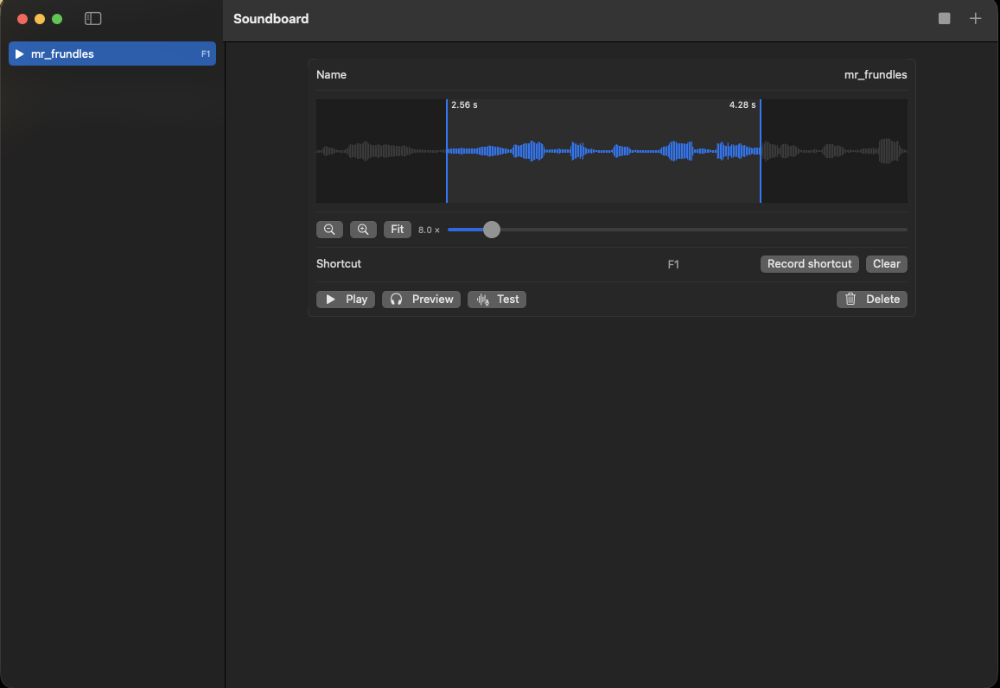

# Soundboard

A free, open-source macOS soundboard, like Soundpad on Windows: play sounds into your microphone in games and Discord.



## Features

- Import sounds with drag and drop.
- Trim each sound with draggable start and end bars on the waveform, with a playhead that follows playback.
- Zoom into the waveform to place the bars precisely.
- Global shortcuts that work while a game has the focus.
- Your microphone and the sounds are mixed into BlackHole, so other players hear both.
- You hear the sounds yourself on your default output.
- A Test button to hear exactly what other players hear.
- Near-zero CPU at idle.
- No menu bar item, no login item, no background process: nothing keeps running after you quit.

## Requirements

- macOS 14 or later.
- Command Line Tools (Xcode is not required).
- [BlackHole 2ch](https://github.com/ExistentialAudio/BlackHole). Without it the app still plays sounds locally and shows a banner.

## Install

1. Install BlackHole. The installer asks for the admin password:

   ```bash
   brew install --cask blackhole-2ch
   ```

   A reboot may be needed, or run `sudo killall coreaudiod` to reload the audio service.

2. Clone and build the app:

   ```bash
   git clone https://github.com/olivierapex/soundboard.git
   cd soundboard
   scripts/build-app.sh
   ```

3. Copy `build/Soundboard.app` to `/Applications`.
4. Start the app and grant microphone access when macOS asks.

## Usage

1. Add sounds with the + button or by dropping audio files on the window.
2. Select a sound to rename it, trim it, record a shortcut or delete it.
3. Play it with the play button or its shortcut. A new sound replaces the one playing. Stop ends it.
4. In the game or Discord, select **BlackHole 2ch** as the microphone.

Good to know:

- When the app is closed, the BlackHole microphone is silent. Switch back to your real microphone.
- Never set BlackHole as the system default input: the app would read its own output and create a feedback loop. Select it only inside the game or Discord.
- Shortcuts can be single keys such as F-keys. Other keys need a modifier. Escape alone cancels the recording. A shortcut needs a key combination that no other app has registered.
- Zoom with a pinch on the trackpad, or with the zoom buttons (up to 64 times). **Fit** shows the whole sound. When zoomed, scroll horizontally on the waveform.
- **Test** plays the trimmed sound to BlackHole and plays back what BlackHole receives (your microphone and the sound) on your default output. The listening stops when the sound ends. It plays your own voice back, so use headphones to avoid feedback.

## How it works

- Your microphone is read into a ring buffer, and an output engine sends it to BlackHole 2ch together with the sound being played.
- A separate monitor engine plays the sound on your default output, only while a sound plays.
- The ring buffer drops old samples when it grows too long and plays silence while it refills, which absorbs clock drift between devices.
- BlackHole is found by name through Core Audio. Device changes are handled by listeners, with no timers and no polling.

## Troubleshooting

### BlackHole 0.7.1 package signature verification failure

The installer of BlackHole 0.7.1 can fail its signature verification. See [ExistentialAudio/BlackHole#903](https://github.com/ExistentialAudio/BlackHole/issues/903) for the status and workarounds.

### Reset the microphone permission

```bash
tccutil reset Microphone io.github.olivierapex.soundboard
```

Then start the app again to get the prompt. Rebuilding changes the ad-hoc signature, so macOS may ask again.

### A shortcut does not fire

Another app registered the same key combination first, and macOS gives it to that app only. The detail view shows "Another app already uses this shortcut." (or "Another sound in this app..." for a duplicate inside Soundboard). Record a different combination.

### Build fails with `could not build module '_DarwinFoundation1'`

The Swift 6.1 toolchain from swiftly cannot read the macOS 27 SDK of the Command Line Tools. Use the Command Line Tools compiler (`/usr/bin/swift`, Swift 6.4). `scripts/build-app.sh` does this.

### Build fails with `external macro implementation type 'SwiftUIMacros.StateMacro' could not be found`

In the macOS 27 SDK, SwiftUI property wrappers such as `@State` are macros whose plugin ships only with Xcode. `scripts/build-app.sh` builds against the macOS 26 SDK (`SDKROOT`, override it if needed). The app still targets macOS 14.

### `ld: warning: search path ... CommandLineTools/Developer/... not found`

Harmless linker warnings caused by the Command Line Tools layout.

### `accessing build database ... disk I/O error`

A cloud-synced folder (Google Drive for desktop, for example) can hard-link files while it uploads them. SQLite, which stores the build database, fails when its files are hard-linked during a build, so `swift build` reports this error and exits with code 1 even though it prints `Build complete!`. `scripts/build-app.sh` therefore builds in `~/Library/Caches/Soundboard/build`, outside the synced folder. Remove a stale `.build` folder left by earlier runs.

## License

[MIT](LICENSE)
